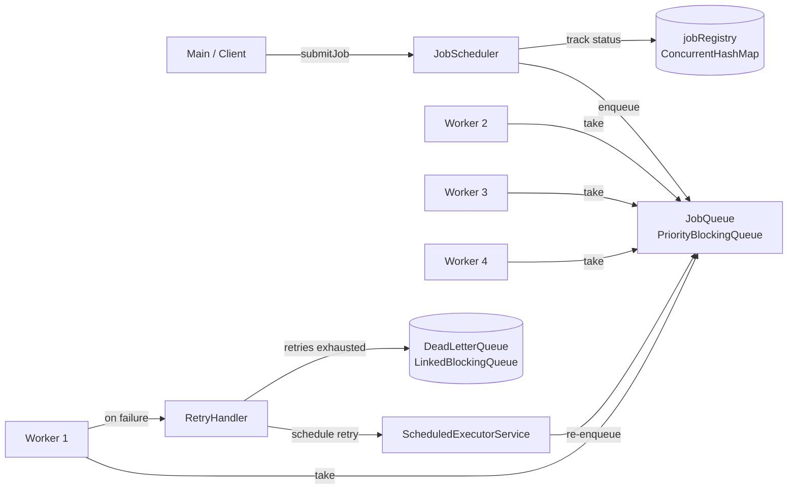

# Concurrent Job Scheduler (Core Java)

A small, interview-friendly **Concurrent Job Scheduler** built with **Core Java only**
(no Spring, no external libraries, no Maven/Gradle, no database). It demonstrates
OOP, data structures, multithreading, and thread safety through a working
producer–consumer job system.

## Project overview

This project submits jobs with a name, priority, and task into a thread-safe
priority queue. A fixed pool of worker threads executes jobs concurrently,
higher-priority jobs first, with FIFO ordering for equal priorities. Failed jobs
are retried with exponential backoff by a separate scheduler; jobs that exhaust
all retries move to a Dead Letter Queue (DLQ). The scheduler supports graceful
shutdown.

## What the project does

1. Accepts job submissions with unique IDs and HIGH / MEDIUM / LOW priority.
2. Orders waiting jobs by priority, then by insertion order (FIFO tie-break).
3. Executes jobs concurrently on a fixed worker thread pool.
4. Tracks each job's status: PENDING, RUNNING, COMPLETED, FAILED.
5. Retries failed jobs up to a configurable max, with exponential backoff.
6. Moves permanently failed jobs to a Dead Letter Queue for inspection.
7. Shuts down gracefully: stops accepting jobs, finishes running jobs, then exits.

## Why it is needed / problems it solves

- Shows a real producer–consumer system using only the JDK concurrency API.
- Demonstrates correct, explainable thread safety (no data races on shared state).
- Provides a portfolio piece for SDE-1 interviews: every class is small and
  every decision is explainable (why a priority queue, why a sequence number,
  why a separate retry scheduler, why workers never sleep).

## Architecture



## Class responsibilities

| Class | Responsibility |
|---|---|
| `JobPriority` | Enum LOW/MEDIUM/HIGH with a numeric level for ordering. |
| `JobStatus` | Enum PENDING / RUNNING / COMPLETED / FAILED. |
| `Job` | Immutable metadata (id, name, priority, task, sequence, maxRetries) + volatile status + atomic attempts. `Comparable` for queue ordering. |
| `JobQueue` | Wraps `PriorityBlockingQueue`; assigns monotonic sequence numbers for FIFO tie-breaks. |
| `Worker` | Runnable loop that polls the queue, runs jobs, and delegates failures to `RetryHandler`. |
| `RetryHandler` | Schedules retries with exponential backoff on a `ScheduledExecutorService`; sends exhausted jobs to the DLQ. |
| `DeadLetterQueue` | `LinkedBlockingQueue` holding permanently failed jobs for inspection. |
| `JobScheduler` | Orchestrator: registry (`ConcurrentHashMap`), worker pool, retry scheduler, submission + shutdown control. |
| `Main` | End-to-end demo of every feature. |
| `SchedulerTest` | 10 deterministic concurrency test scenarios. |

## Execution workflow

1. `JobScheduler` starts: creates queue, DLQ, retry scheduler, fixed worker pool, and starts `Worker`s.
2. Client calls `submitJob(name, priority, task)`. Scheduler assigns a sequence number and ID, stores the job in `jobRegistry`, and enqueues it. Status = PENDING.
3. A `Worker` takes the highest-priority job (priority first, then sequence). Status = RUNNING.
4. The worker runs the task. On success: status = COMPLETED. On exception: status = FAILED and the job is handed to `RetryHandler`.
5. `RetryHandler` computes `baseBackoff * 2^(attempt-1)` and schedules a re-enqueue on the `ScheduledExecutorService`. The worker thread is NOT blocked.
6. If a retry attempt still fails, the cycle repeats; when attempts exceed maxRetries, the job moves to the DLQ.
7. On `shutdown()`: stop accepting jobs, let workers drain the queue, then terminate both executors.

## Data structures used and why

- **`PriorityBlockingQueue<Job>`** — unbounded, thread-safe, O(log n) insert/remove, and orders by our `compareTo`. Perfect for priority scheduling.
- **Sequence number (`AtomicInteger`)** — `PriorityBlockingQueue` is not stable for equal elements, so the sequence breaks ties to guarantee FIFO among equal priorities.
- **`ConcurrentHashMap<String, Job>`** — O(1) status lookup by ID, thread-safe without external locking.
- **`LinkedBlockingQueue<Job>` (DLQ)** — simple, thread-safe holding area for permanently failed jobs.
- **`AtomicInteger` / `volatile`** — attempts counter and status/shutdown flags with safe publication.

## Important Java concepts demonstrated

`PriorityBlockingQueue`, `BlockingQueue`, `ExecutorService`, `ScheduledExecutorService`,
`Runnable`, lambdas, `ConcurrentHashMap`, `AtomicInteger`, `AtomicBoolean`,
`Comparable`, `CountDownLatch` (tests), producer–consumer pattern, exception
handling, and graceful shutdown via `shutdown()` + `awaitTermination()`.

## Time & space complexity

- Submit: O(log n) queue insert; status lookup O(1).
- Take/poll: O(log n).
- Retry scheduling: O(1) per failure.
- Space: O(n) for n live jobs in queue + registry.

## Thread safety

- Queue and registry are concurrent collections; no manual locking needed.
- `Job.status` is `volatile`; `attempts` is `AtomicInteger`; shutdown flags are
  `AtomicBoolean`/`volatile`, so cross-thread visibility is guaranteed.
- Workers never sleep; retry delays live on the separate scheduler thread pool.

## Edge cases

- Submission after shutdown → `IllegalStateException`.
- `maxRetries = 0` → a failing job goes straight to the DLQ.
- Equal priorities → FIFO by sequence number.
- Retry scheduled while scheduler is shutting down → `RejectedExecutionException`
  is caught and the job is moved to the DLQ instead of being lost.

## Limitations (honest)

- Interview/demo project, not production-grade: no persistence, no metrics, no
  distributed coordination, no priority preemption of running jobs.
- `PriorityBlockingQueue` is unbounded, so extreme submission rates could grow
  memory (acceptable for a demo).
- Timing-based assertions are avoided; backoff is verified via `computeDelayMillis`.

## Future improvements

- Per-priority worker pools; job cancellation; persistence of DLQ; JMX metrics;
  bounded queue with rejection policy; configurable retry per job via API.

## Compile & run (Windows PowerShell)

```powershell
cd C:\Users\keert\Desktop\Concurrent-Job-Scheduler

# compile all sources into ./out
javac -d out src/com/scheduler/*.java

# run the demo
java -cp out com.scheduler.Main

# run the tests (exit code 0 = all pass)
java -cp out com.scheduler.SchedulerTest
```

## Folder structure

```
Concurrent-Job-Scheduler/
├── README.md
└── src/
    └── com/
        └── scheduler/
            ├── Job.java
            ├── JobPriority.java
            ├── JobStatus.java
            ├── JobQueue.java
            ├── Worker.java
            ├── RetryHandler.java
            ├── DeadLetterQueue.java
            ├── JobScheduler.java
            ├── Main.java
            └── SchedulerTest.java
```